# OpenTwin Agentic AI Hospital & Healthcare Management Platform

> Open, modular reference architecture for hospital information systems,
> healthcare operations, emergency response, medical logistics,
> interoperable clinical data, AI-assisted decision support, and digital
> twins.

## Description and Context

**jfxhms / OpenTwin AI Hospital & Healthcare Management Platform**
consolidates the project technology compendium into a coherent
architecture for healthcare information management, hospital operations,
emergency medical services, logistics, interoperability, AI and digital
twins.

The architecture covers HIS/EHR/EMR, HL7 FHIR, CQL, laboratory
workflows, hospital ERP, insurance/financing, ambulance CAD/AVL, medical
supply chains, analytics, AI/ML, MBSE and simulation.

Referenced technologies are classified as **required dependencies,
optional integrations, or research references**, rather than being
treated as one mandatory runtime stack.

**Design principle:** open, modular architecture designed to minimize
proprietary lock-in and enable independent implementations.

## High-level technical specification and SysML

[HMS-MBSE-001 specification](docs/requirements/high-level-technical-specification.md) integrates ten proposed platform requirements and the 36 existing CAD-aligned fleet requirements. [Combined traceability](docs/requirements/high-level-requirements-traceability.csv) and [12 editable SysML views](MBSE/CAS/Drawio/JFXHMS_High_Level_SysML.drawio) define candidate satisfaction allocations, planned verification, logical blocks, data boundaries, supervised modes and release gates. Evidence, quantitative budgets and deployment remain pending. Next proposed work package: HMS-PILOT-002, an offline synthetic encounter-to-mission-handover harness.

## CAD-aligned requirements baseline

[Medical-fleet requirements and CAD traceability](docs/requirements/cad-concept-requirements.md) links the three illustrated marine concepts to four editable Drawio specifications: common requirements, medical patrol boat, modular medical vessel, and large medical support ship. Each proposed requirement has an ID, allocation, verification method and acceptance criterion. Dimensions, occupancy, power, operating envelopes and evidence remain pending; dashboard examples are not performance limits.

The diagrams below describe a proposed architecture, not deployed services. Solid arrows indicate primary data or workflow relationships; dotted arrows indicate constrained feedback, supporting evidence or cross-cutting governance. Clinical records remain separately governed from ordinary asset telemetry.

## Vision

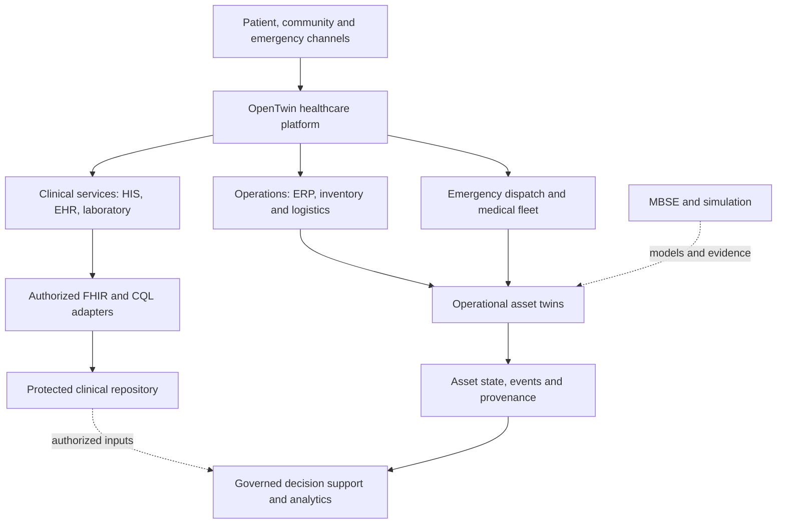

## Objectives

-   Modular healthcare-management architecture.
-   Clinical and administrative workflow integration.
-   Standards-oriented healthcare interoperability.
-   Digital twins for facilities, equipment, beds, ambulances and
    logistics assets.
-   Emergency dispatch and medical transportation integration.
-   Laboratory and diagnostic workflows.
-   ERP, inventory and medical supply-chain integration.
-   AI-assisted analytics with qualified human oversight.
-   Provenance, auditability and privacy by design.
-   MBSE and simulation.
-   Replaceable adapters and implementation-independent interfaces.
-   No mandatory proprietary cloud, EHR or AI provider.

## Reference Architecture

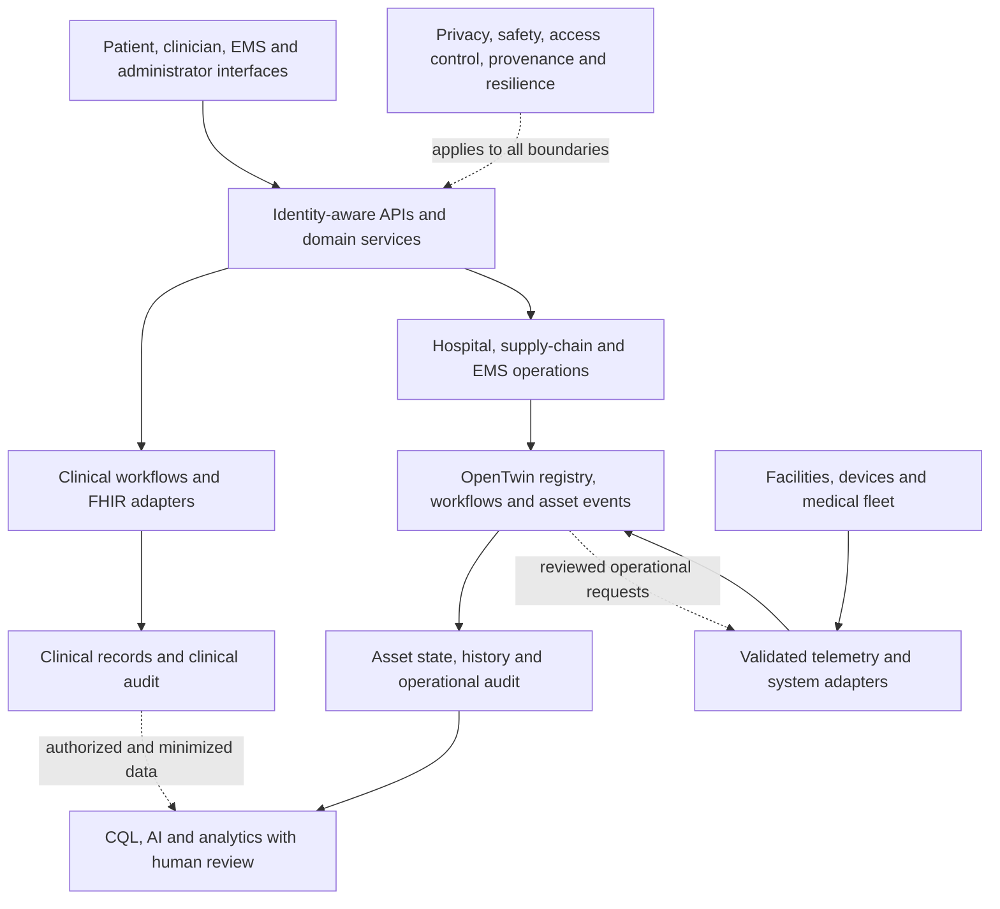

Cross-cutting concerns: **Identity · Privacy · Cybersecurity · Patient
Safety · Clinical Governance · Audit · Provenance · Observability ·
Resilience · Licensing**.

## Healthcare Digital Twin Model

Candidate twins:

-   Hospital Twin
-   Department/Ward Twin
-   Bed Twin
-   Operating Room Twin
-   Laboratory Twin
-   Medical Device Twin
-   Pharmacy Twin
-   Inventory Twin
-   Ambulance Twin
-   Medical Patrol Boat Twin
-   Hospital Ship Twin
-   Air-Medical Asset Twin
-   Warehouse Twin
-   Emergency Mission Twin

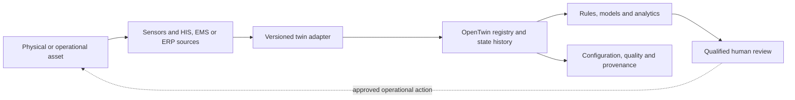

Example:

``` yaml
twin:
  id: ambulance-001
  type: medical-transport
  state:
    operational_status: available
    location: {}
    energy: {}
    equipment_status: {}
    environmental_state: {}
  telemetry_refs: []
  maintenance_refs: []
  relationships: []
  provenance: {}
```

Clinical records and physical-asset twins should remain logically
separated because patient information requires stricter governance than
ordinary equipment telemetry.

## Clinical Information and Interoperability

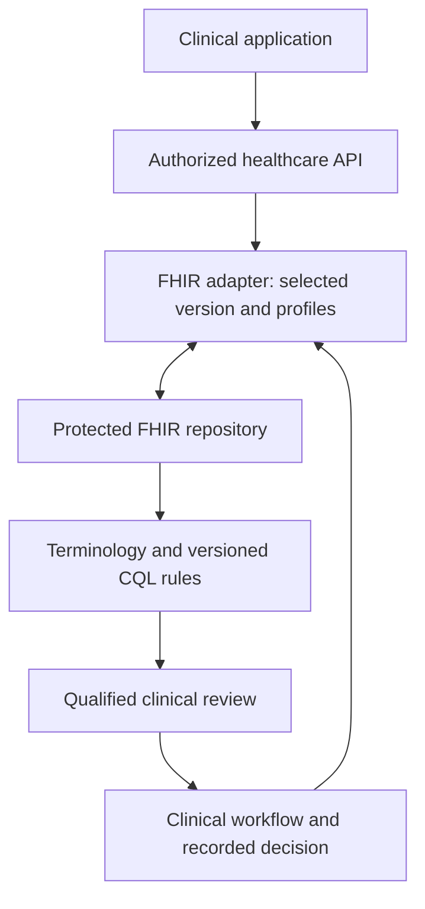

Candidate resources include patients, encounters, observations,
conditions, procedures, medications, diagnostic reports, appointments,
practitioners, organizations, locations, care plans, consent and
provenance.

FHIR compatibility should be defined by version, profiles,
implementation guides, terminology bindings and conformance tests.

## Hospital Operations

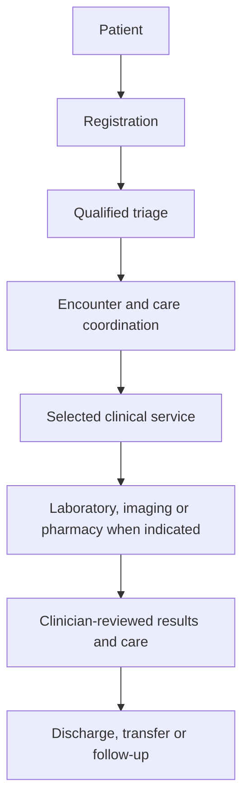

Administrative capabilities may include appointments, beds, departments,
operating rooms, staffing, billing, procurement, inventory, pharmacy,
maintenance, reporting and quality indicators.

## Emergency Medical Services

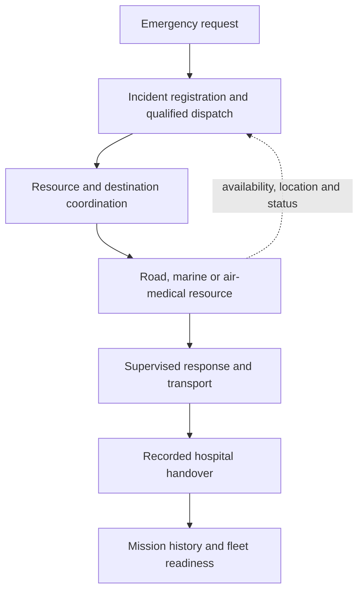

Candidate capabilities include incident registration, dispatch, unit
availability, GPS/AVL, routing, ETA, destination coordination, handover,
mission history and fleet maintenance.

Safety-critical dispatch decisions require validated procedures and
qualified human oversight.

## OpenTwin Medical Fleet

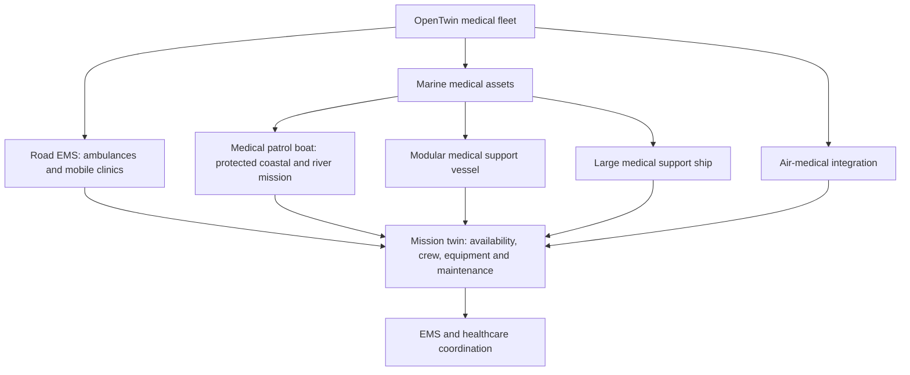

The fleet model supports road ambulances/mobile clinics, marine medical
patrol/rescue craft and hospital vessels, and air-medical assets. It is
an extensible reference architecture and does not claim that every
physical platform is already implemented.

## AI and Clinical Decision Support

Potential functions include operational forecasting, capacity planning,
appointment optimization, supply forecasting, anomaly detection,
clinical NLP research, coding assistance, risk stratification,
medical-logistics optimization and predictive maintenance.

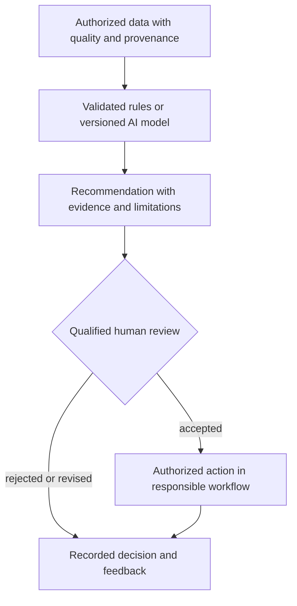

AI output should expose model identity/version, timestamp, input
provenance, limitations and review status. AI must not be represented as
autonomous diagnostic or treatment authority without the validation,
governance and regulatory processes required for the deployment.

## Laboratory and Diagnostics

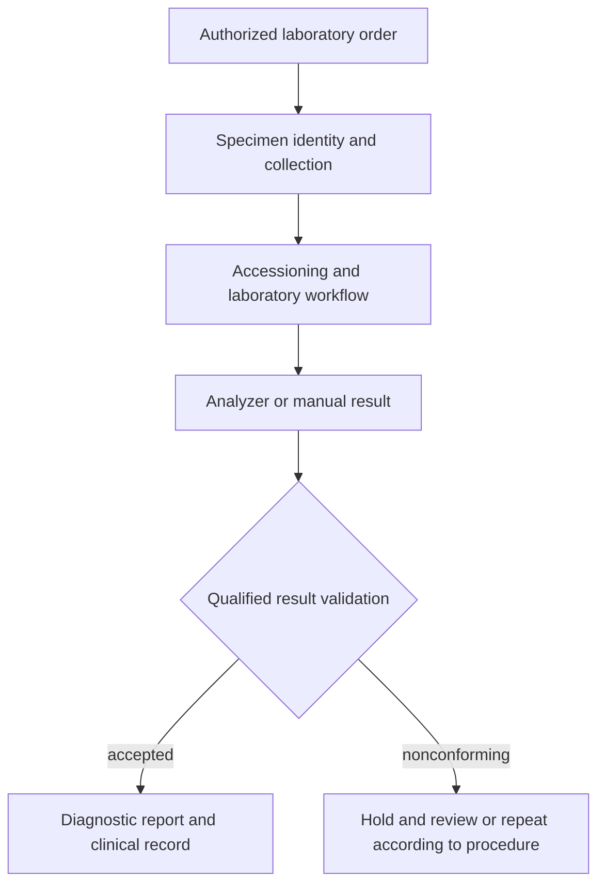

Functions may include test catalogs, sample identification,
accessioning, analyzer integration, result validation, quality control,
reporting and traceability.

## Healthcare ERP, Supply Chain and Financing

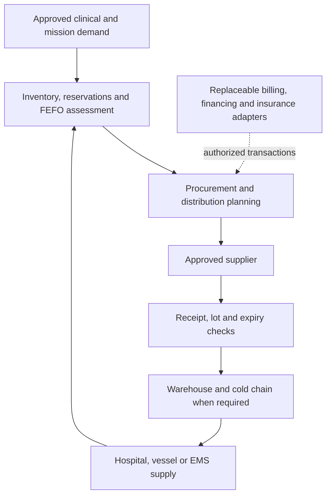

Potential capabilities include procurement, inventory, medical supplies,
pharmaceuticals, warehouses, lot/expiration tracking, suppliers,
purchase orders, distribution, equipment and maintenance.

Insurance, claims, eligibility, public financing, billing and
reimbursement should be isolated behind replaceable adapters.

## Data and Event Architecture

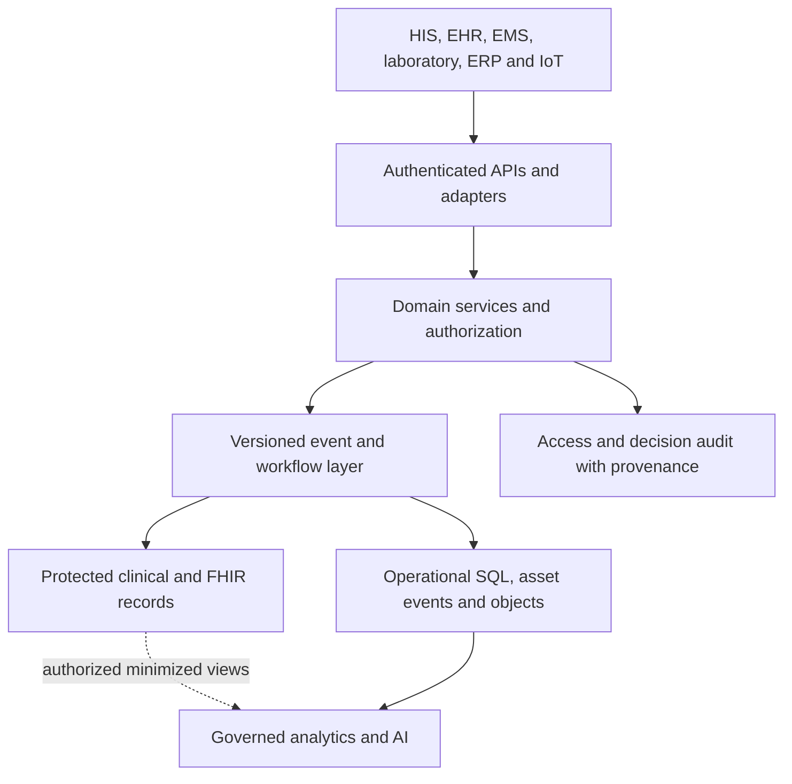

Example events:

``` text
patient.registered
encounter.started
appointment.created
bed.status.changed
lab.order.created
lab.result.validated
ambulance.dispatched
ambulance.arrived
patient.handover.completed
inventory.stock.changed
medical.asset.maintenance.required
```

Sensitive event payloads should minimize protected information and
enforce appropriate authorization.

## Open Modular APIs

Potential service boundaries:

``` text
Patient API
Encounter API
Appointment API
Practitioner API
Facility API
Bed API
Laboratory API
Pharmacy API
Inventory API
Procurement API
Emergency API
Dispatch API
Fleet API
Telemetry API
Twin API
FHIR API
CQL/CDS API
AI API
Analytics API
Audit API
```

Clinical interoperability should prefer applicable healthcare standards
rather than creating incompatible proprietary representations.

## Security, Privacy and Safety

Recommended controls:

-   OIDC/OAuth2-compatible identity and MFA for privileged roles;
-   RBAC/ABAC and least privilege;
-   encryption in transit and appropriate protection at rest;
-   secrets management;
-   immutable/auditable security and clinical-event trails where
    required;
-   consent-aware access where applicable;
-   data minimization and retention controls;
-   pseudonymization/de-identification for appropriate secondary uses;
-   backup, recovery and disaster-recovery planning;
-   network segmentation;
-   secure software updates and signed artifacts;
-   dependency/vulnerability scanning;
-   medical-device network isolation where required;
-   incident response.

Applicable healthcare, privacy, medical-device and cybersecurity
obligations must be identified during requirements engineering for each
jurisdiction.

## MBSE and Simulation

The engineering approach preserves:

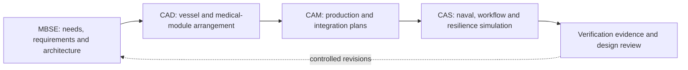

Arcadia/Capella can structure stakeholder needs, operational analysis,
system analysis, logical architecture, physical architecture,
implementation and verification.

Potential simulation subjects include hospital capacity, patient flow,
emergency response, ambulance deployment, medical-fleet logistics,
inventory, energy resilience, evacuation and disaster response.

## Open-Source Technology Compendium

| Domain | Candidate / Reference | Potential role |
| --- | --- | --- |
| Healthcare AI | KARMA | AI research/reference |
| Healthcare AI | TALENT | Healthcare AI reference |
| Healthcare Platform | Marley Health | Healthcare software reference |
| ML / Healthcare | pyHealth | Healthcare ML research |
| Emergency | MedRescue | Medical-response reference |
| HIS | Open Hospital | Hospital information system |
| EMR | Danphe EMR | EMR reference |
| Clinical Rules | CQL | Clinical quality/rules language |
| Clinical Decision Support | Citrus | CDS reference |
| Expert Systems | d3web | Knowledge-based decision support |
| HIS/ERP | OpenClinic GA | Hospital/clinic management |
| Health Financing | openIMIS | Health financing/insurance |
| FHIR | HAPI FHIR | FHIR implementation framework |
| Laboratory | OpenHMIS / iSkyLIMS | Laboratory references |
| Integration | IPF | Healthcare integration framework |
| CQL/FHIR | Blaze | Clinical interoperability reference |
| EMS | CAD / AVL | Dispatch/location architecture |
| Supply Chain | OpenBoxes | Medical supply-chain reference |
| MBSE | Capella / Arcadia | Systems engineering |
| Database | PostgreSQL | Relational persistence |
| Containers | Docker | Reproducible deployment |
| Orchestration | Kubernetes | Scalable deployment |
| APIs | OpenAPI / AsyncAPI | Interface contracts |

Inclusion does not imply endorsement, bundling, mandatory dependency,
regulatory approval or current compatibility. Verify license, security,
maintenance, interoperability and deployment suitability before
adoption.

## User Guide

1.  Register the healthcare organization.
2.  Configure facilities and departments.
3.  Register authorized users and roles.
4.  Configure operational services.
5.  Connect approved HIS/FHIR adapters.
6.  Configure laboratory and inventory modules.
7.  Register physical assets and digital twins.
8.  Configure emergency-response resources.
9.  Connect authorized telemetry.
10. Operate hospital/EMS workflows.
11. Review audit and provenance records.
12. Use approved analytics/decision-support functions.
13. Require appropriate human review for consequential actions.

## Installation Guide

``` bash
git clone https://github.com/robotics-intelligent-systems/jfxhms.git
cd jfxhms
```

The repository should be treated as a technology compendium/reference
architecture unless a specific executable module documents otherwise. Do
not assume every referenced healthcare project must be installed.

Minimal target:

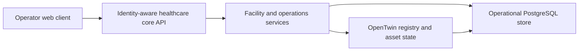

Extended deployments can add FHIR, event broker, object storage,
HIS/EHR, laboratory, ERP/supply-chain, EMS/CAD, fleet/telemetry, AI/CDS,
analytics and audit/provenance adapters.

Executable modules should document tested runtimes, environment
variables, package managers, migrations, tests, networking, storage,
secrets and security configuration.

## Dependencies

### Required Dependencies

Only components necessary for the selected executable deployment.

### Optional Integrations

Examples include HAPI FHIR, Open Hospital, OpenClinic GA, Danphe EMR,
openIMIS, OpenBoxes, laboratory systems, CAD/AVL, AI/ML frameworks,
Capella, PostgreSQL, Docker and Kubernetes.

### Research References

Projects used for architectural comparison, experimentation or research
without becoming runtime dependencies.

Recommended record:

``` yaml
dependency:
  name:
  version:
  role:
  status: required | optional | reference
  license:
  source:
  tested_platforms:
  security_notes:
  healthcare_interoperability:
  regulatory_notes:
```

## Recommended Repository Structure

``` text
jfxhms/
├── README.md
├── LICENSE
├── CONTRIBUTING.md
├── CODE_OF_CONDUCT.md
├── docs/
│   ├── architecture/
│   ├── clinical/
│   ├── interoperability/
│   ├── security/
│   └── operations/
├── mbse/
├── core/
│   ├── organizations/
│   ├── facilities/
│   ├── departments/
│   └── assets/
├── clinical/
├── interoperability/
│   ├── fhir/
│   ├── cql/
│   └── terminology/
├── twins/
│   ├── registry/
│   ├── state/
│   └── adapters/
├── laboratory/
├── pharmacy/
├── inventory/
├── supply-chain/
├── emergency/
│   ├── dispatch/
│   ├── ambulance/
│   ├── marine/
│   └── air-medical/
├── ai/
├── analytics/
├── api/
├── events/
├── audit/
├── integrations/
├── simulation/
├── deployment/
├── tests/
└── examples/
```

## MVP

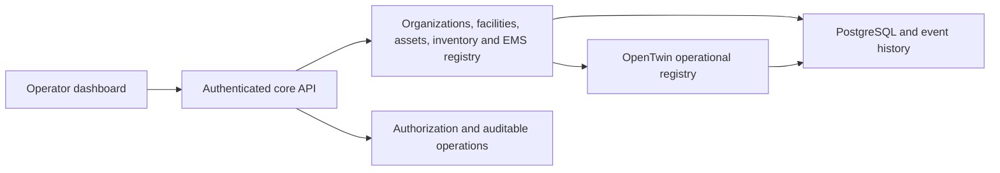

MVP features:

-   healthcare organization registry;
-   facilities/departments;
-   medical asset registry;
-   OpenTwin asset state/history;
-   emergency-unit registry;
-   ambulance availability/location;
-   basic inventory;
-   event/audit history;
-   REST API;
-   operator dashboard;
-   containerized local deployment.

Success criteria include reproducible deployment, protected sensitive
functions, auditable inventory changes, operational asset tracking and
no mandatory proprietary cloud.

Clinical EHR/CDS functionality should be introduced through a dedicated
interoperability, privacy, safety and validation workstream.

## Development Roadmap

### Phase 1 --- Architecture and Documentation

-   [x] BID-inspired README organization.
-   [x] Technology-compendium consolidation.
-   [x] OpenTwin healthcare architecture.
-   [x] Medical-fleet extension.
-   [ ] Architecture Decision Records.
-   [ ] Formal schemas.

### Phase 2 --- Operational Core

-   [ ] Organizations/facilities/departments.
-   [ ] Asset registry.
-   [ ] Inventory.
-   [ ] Identity/authorization.
-   [ ] Audit/provenance.

### Phase 3 --- Digital Twins

-   [ ] Twin registry/state/history.
-   [ ] Equipment adapters.
-   [ ] Fleet twins.
-   [ ] Maintenance workflows.

### Phase 4 --- Emergency Medical Services

-   [ ] Incident management.
-   [ ] Dispatch.
-   [ ] Ambulance tracking.
-   [ ] Marine medical assets.
-   [ ] Air-medical adapters.
-   [ ] Hospital handover.

### Phase 5 --- Healthcare Interoperability

-   [ ] FHIR adapter.
-   [ ] Profiles/conformance testing.
-   [ ] Terminology integration.
-   [ ] CQL/CDS adapter.
-   [ ] Consent/provenance model.

### Phase 6 --- Hospital Operations

-   [ ] Patient administration.
-   [ ] Scheduling and bed management.
-   [ ] Laboratory/pharmacy.
-   [ ] Supply chain.

### Phase 7 --- AI and Analytics

-   [ ] Operational forecasting.
-   [ ] Capacity optimization.
-   [ ] Medical-logistics optimization.
-   [ ] AI governance/provenance.
-   [ ] Human-review workflows.

### Phase 8 --- MBSE and Simulation

-   [ ] Capella models.
-   [ ] Hospital-flow simulation.
-   [ ] Emergency-response simulation.
-   [ ] Fleet/logistics scenarios.
-   [ ] Resilience scenarios.

### Phase 9 --- Production Hardening

-   [ ] Observability/high availability.
-   [ ] Disaster recovery.
-   [ ] Security/privacy testing.
-   [ ] Performance testing.
-   [ ] Deployment-specific regulatory assessment.

## How to Contribute

Contributions are welcome in healthcare architecture, HIS/EHR
interoperability, FHIR, CQL, clinical workflows, hospital operations,
laboratory systems, ERP, medical logistics, EMS, digital twins, AI/ML,
analytics, MBSE, cybersecurity, privacy and documentation.

``` bash
git checkout -b feature/my-contribution
git add .
git commit -m "Add: description of contribution"
git push origin feature/my-contribution
```

Pull requests should document problem/scope, solution, architecture
impact, interfaces, dependencies, licensing, privacy/security
implications, patient-safety implications, interoperability impact,
tests and documentation.

Never commit credentials, private health information, identifiable
patient datasets, proprietary clinical data or unauthorized third-party
content.

## Code of Conduct

Maintain a respectful, inclusive, professional and technically
constructive environment. A dedicated `CODE_OF_CONDUCT.md` should be
maintained at repository root.

## Authors and Maintainers

Maintained by the **Robotics Intelligent Systems** open-source
initiative.

Repository: `robotics-intelligent-systems/jfxhms`

Third-party software, standards, datasets, trademarks and reference
projects remain the property of their respective owners.

## Intellectual Property and Open Design

OpenTwin Healthcare favors open standards, documented interfaces,
modular adapters, replaceable implementations, explicit provenance,
appropriately licensed dependencies and reproducible engineering
artifacts.

The objective is to minimize proprietary lock-in and permit
independently developed compatible modules.

Open-source licensing does not itself guarantee freedom from third-party
patents, trademarks, medical-device rights or other
intellectual-property claims. Implementers remain responsible for
appropriate jurisdiction-specific review.

## Disclaimer

**jfxhms / OpenTwin AI Hospital & Healthcare Management Platform is a
research, educational and engineering project.**

It is not, by itself, a certified medical device, approved clinical
decision system, emergency-dispatch authority or substitute for
qualified healthcare professionals.

Clinical AI, analytics, simulations and digital-twin outputs may be
incomplete or inaccurate. Consequential medical or safety decisions
require qualified human review and the validation, governance and
regulatory approval applicable to the deployment.

The BID repository template is used solely as a
**documentation-structure reference**. jfxhms does not claim BID/IDB
funding, sponsorship, endorsement, catalog membership or institutional
affiliation.

## License

The actual jfxhms license should remain in the repository root as
`LICENSE`, `LICENSE.md`, or its existing equivalent.

Third-party libraries, healthcare-standard implementations, datasets,
models and documentation retain their respective licenses and terms.

Do not automatically apply BID/IDB institutional copyright, software
licensing language, funding statements or disclaimers merely because its
documentation template informed this README.

------------------------------------------------------------------------

## OpenTwin Healthcare Principles

**Open Architecture · Healthcare Interoperability · Modular Digital
Twins · Human Oversight · Privacy by Design · Provenance · Safety ·
Reproducibility**

> Connect hospital operations without locking them to one vendor.\
> Connect physical healthcare assets to auditable digital twins.\
> Connect emergency medical fleets to the healthcare network.\
> Use open interoperability standards where appropriate.\
> Use AI as governed decision support.\
> Keep safety-critical authority under validated human and system
> controls.
